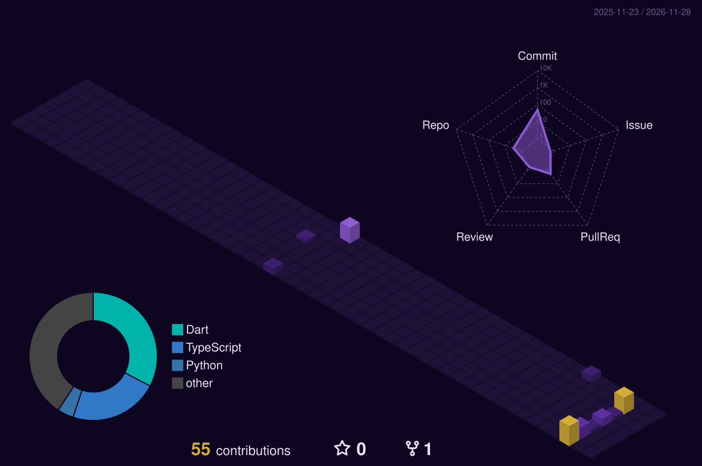

  

  

  <!-- TODO: replace the # links with your real URLs -->
  
  
  

AI student at Taylor's University, Malaysia. I build agentic AI, RAG pipelines and ML models.

  
    
  
    
  

| | |
|---|---|
| **Contract Companion** | Agentic RAG for legal documents |
| **VoxelSort** | Chest X-ray worklist prioritiser |
| **VendorGuard** | Procurement fraud detection |
| **[TCG Grader](https://github.com/Hgt1-0/tcg-grader)** | Card grading and NFT minting on Solana |

  

  

  

  
  
  

  

